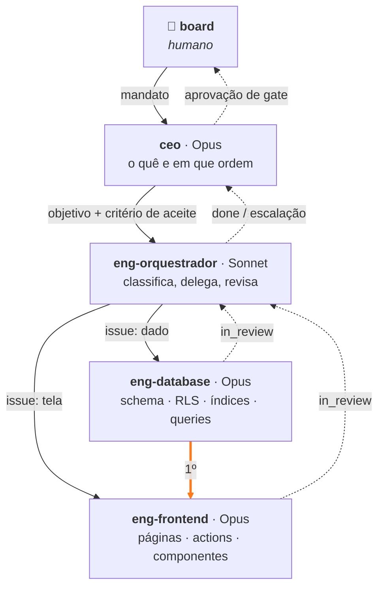

# Eng Company

**Uma company de 4 agentes que sabe construir SaaS multi-tenant** em Next.js 16 + Prisma 7 + Postgres/Supabase com Row Level Security.

Funciona em dois modos, com os mesmos agentes e as mesmas skills:

| Modo | Como |
|------|------|
| **Claude Code** | `git clone` → `./scripts/install.sh` → chame `eng-ceo` |
| **Paperclip** | `paperclipai company import .` — este repo já é um package `agentcompanies/v1` |

---

## Como os agentes estão orquestrados



A seta laranja é a única dependência horizontal do sistema: **numa feature vertical, o dado vem antes da tela.** Interface construída sobre um shape que ainda vai mudar é retrabalho — e aqui o retrabalho é de RLS, o tipo caro.

Cada tier decide uma coluna, nunca duas:

| Tier | Agente | Decide | **Não** decide |
|------|--------|--------|----------------|
| CEO | `ceo` | o quê fazer, em que ordem, o que fica de fora | como implementar |
| PM | `eng-orquestrador` | quem faz, com qual skill, qual o critério de aceite | o quê fazer |
| IC | `eng-database` | como modelar, indexar, isolar | o quê fazer, quem faz |
| IC | `eng-frontend` | como estruturar tela, componente, estado | o quê fazer, quem faz |

📖 **Fluxo completo, diagramas de sequência, tabela de roteamento e regras de escalação: [`docs/orquestracao.md`](docs/orquestracao.md)**

---

## As 5 skills

| Skill | Dispara em | Agente |
|-------|-----------|--------|
| [`eng-prisma-schema`](skills/eng-prisma-schema/SKILL.md) | criar tabela, campo, enum, migration, seed, tipo de coluna | `eng-database` |
| [`eng-rls-multitenant`](skills/eng-rls-multitenant/SKILL.md) | policy, isolamento, `forUser`/`forService`, webhook, vazamento | `eng-database` |
| [`eng-query-performance`](skills/eng-query-performance/SKILL.md) | lentidão, N+1, índice, `EXPLAIN`, agregação, pool de conexão | `eng-database` |
| [`eng-next-app`](skills/eng-next-app/SKILL.md) | página, rota, Server Action, guarda de auth, cache, fronteira | `eng-frontend` |
| [`eng-ui-system`](skills/eng-ui-system/SKILL.md) | componente, cor, token, gráfico, estado vazio, responsivo | `eng-frontend` |

O formato `agentskills/v1` é comum ao Claude Code e ao Paperclip — as mesmas skills servem aos dois.

---

## O que elas realmente sabem

Não é conselho genérico de "boas práticas". São decisões concretas com o motivo junto:

**Banco**
- Id `uuid` **nativo** (`@db.Uuid`), porque com coluna de texto cada linha avaliada pela policy paga um cast e **perde o índice**
- `clinicId` desnormalizado onde a tabela cresce — é o que faz a policy virar index scan em vez de dois joins por linha
- `lead_events` e `audit_logs` append-only: um lead em `WON` também *passou* por `SCHEDULED`, e o estado atual não guarda isso
- Migration destrutiva **sempre** em duas fases — o Vercel serve a versão velha e a nova ao mesmo tempo por alguns segundos

**Isolamento**
- `set_config(..., true)` obrigatório: é `SET LOCAL`. O Supabase usa pgBouncer em transaction mode na 6543 — com `false`, a identidade vaza entre requisições de clientes diferentes
- Policies geradas em laço, não copiadas 20 vezes: policy escrita à mão é onde mora o erro de digitação que abre o tenant
- Role da aplicação sem `bypassrls` — trocar por `postgres` derruba o isolamento **em silêncio**
- 404 em vez de 403: dizer "existe, mas você não pode" permite descobrir a carteira de clientes chutando slugs

**Interface**
- `params` é `Promise` no Next 16; Server Action é endpoint público, então o guarda se repete em toda uma
- `import { prisma }` bloqueado por eslint em `src/app/**`
- Vermelho é incidente, não "lead perdido" — gastar vermelho em coisa normal faz ninguém enxergar o vermelho que importa quando o WhatsApp cair
- Estágio de funil é dado **ordinal** (rampa de um matiz), série de gráfico é **categórico** (matizes distintos). Trocar os dois faz o kanban virar arco-íris

> **Por que Opus nos ICs e não Sonnet.** Uma policy de RLS errada não gera exceção — gera o dado do cliente A na tela do cliente B, e ninguém percebe até alguém reclamar. Modelo barato sai caro exatamente onde a falha é silenciosa.

---

## Começar

### Claude Code

```bash
git clone https://github.com/joseneto-code/eng-company.git
cd eng-company
./scripts/install.sh          # Windows: .\scripts\install.ps1
```

Depois, no repositório do seu produto:

```
usa o eng-ceo: quero que o usuário consiga definir meta de faturamento e ver o progresso
```

📖 [`docs/claude-code.md`](docs/claude-code.md)

### Paperclip

```bash
# 1. preencha o mandato (obrigatório)
$EDITOR agents/ceo/references/mandato.md

# 2. secret
paperclipai configure --section secrets     # ANTHROPIC_API_KEY

# 3. import
paperclipai company import . --dry-run
paperclipai company import .

# 4. confirme os 4 agentes e a hierarquia
paperclipai agent list --company-id <uuid>
```

Já vem configurado: roteamento de modelo por tier, `PROTOCOL.md` slim por agente (substitui a skill monolítica de ~3.000 tokens/tick), heartbeat só no CEO e semanal, budget por agente com auto-pause em 100%, e `maxConcurrentPerAgent: 1` — que evita duas migrations com o mesmo timestamp.

📖 [`docs/paperclip.md`](docs/paperclip.md)

---

## Adaptar ao seu produto

**Um arquivo é obrigatório:** `agents/ceo/references/mandato.md`. Sem ele o CEO decide no vácuo.

As skills citam nomes concretos (`clinic_id`, `protocolo_app`, `app.accessible_clinics()`) **de propósito** — é o que faz o agente reconhecer o código real em vez de raciocinar sobre abstração. Se o seu modelo de tenancy usa outros nomes:

```bash
grep -rn "clinic_id\|protocolo_app\|accessible_clinics" skills/
```

Troque pelos seus. Deixar abstrato é o único caminho errado: a skill perde exatamente o que a torna útil.

---

## Estrutura

```
eng-company/
├── COMPANY.md                    # entrypoint agentcompanies/v1
├── .paperclip.yaml               # adapters, routines, budgets, concurrency
├── agents/
│   ├── ceo/                      # AGENTS.md · PROTOCOL.md · references/
│   ├── eng-orquestrador/
│   ├── eng-database/
│   └── eng-frontend/
├── teams/engenharia/TEAM.md
├── skills/                       # ← canônicas, usadas pelos dois modos
│   ├── eng-prisma-schema/
│   ├── eng-rls-multitenant/
│   ├── eng-query-performance/
│   ├── eng-next-app/
│   └── eng-ui-system/
├── .claude/agents/               # mesmos agentes, formato Claude Code
├── memory/shared/MEMORY.md
├── docs/
│   ├── orquestracao.md           # ← comece por aqui
│   ├── paperclip.md
│   └── claude-code.md
└── scripts/install.{sh,ps1}
```

Por que `agents/` e `.claude/agents/` são separados: os formatos de frontmatter são diferentes (`schema`/`kind`/`slug`/`reportsTo` no Paperclip vs. `name`/`description`/`tools`/`model` no Claude Code). As **skills** não duplicam — `agentskills/v1` é comum aos dois, e `skills/` é a fonte única.

---

## Stack que os agentes assumem

Next.js 16 (App Router) · React 19 · Tailwind v4 (`@theme inline`, sem `tailwind.config.js`) · Prisma 7 + `@prisma/adapter-pg` · Postgres no Supabase com RLS · Supabase Auth · `lucide-react` + `recharts` · Vercel

---

## Licença

MIT — ver [LICENSE](LICENSE).

---

<sub>Feito por José Neto.</sub>
