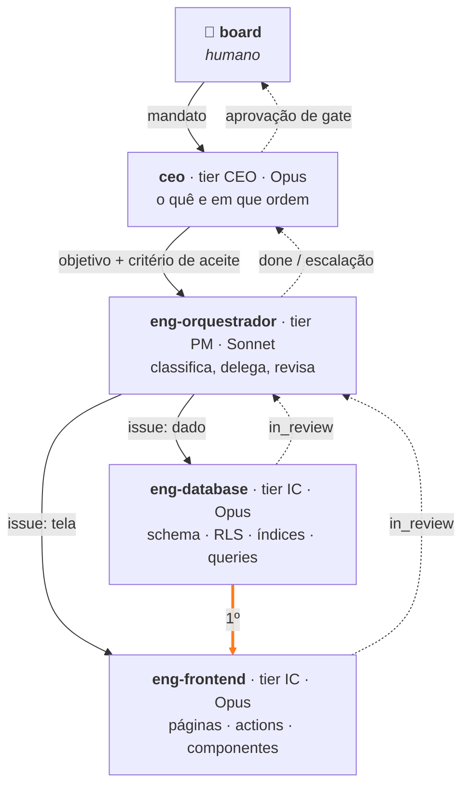
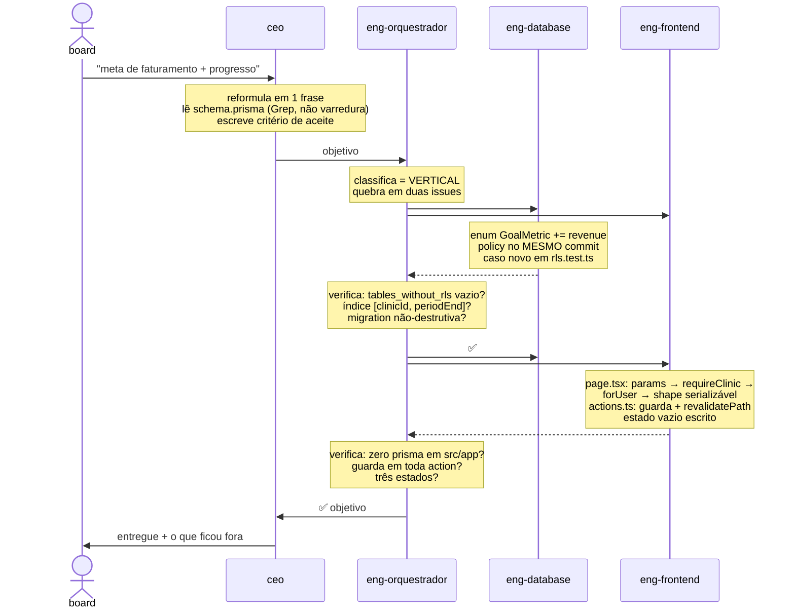
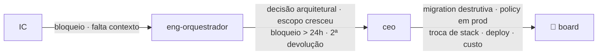

# Como os agentes estão orquestrados

Três tiers, quatro agentes, uma regra de ordem. Este documento mostra quem decide o quê, como o trabalho desce e como ele volta.

---

## 1. A hierarquia



A seta laranja é a única dependência horizontal do sistema: **numa feature vertical, o dado vem antes da tela.**

---

## 2. Quem decide o quê

| Tier | Agente | Decide | **Não** decide |
|------|--------|--------|----------------|
| CEO | `ceo` | o quê fazer, em que ordem, o que fica de fora | como implementar |
| PM | `eng-orquestrador` | quem faz, com qual skill, qual o critério de aceite | o quê fazer, como implementar |
| IC | `eng-database` | como modelar, indexar, isolar | o quê fazer, quem faz |
| IC | `eng-frontend` | como estruturar tela, componente, estado | o quê fazer, quem faz |

Nenhum tier decide duas colunas. Quando um IC decide "o quê", vira escopo fora de controle; quando o CEO decide "como", vira gargalo caro.

---

## 3. As três fronteiras duras

### 3.1 CEO não escreve código

Se o `ceo` abriu um `.tsx` para editar, errou de agente. Ele lê para entender o terreno (`package.json`, `schema.prisma`, a pasta da feature) e delega.

### 3.2 Orquestrador não conserta

Issue devolvida errada volta para o IC com o item específico apontado. O orquestrador **não** conserta "porque é rapidinho" — se ele consertar, ninguém mais valida contra o critério, e o critério era o produto do trabalho dele.

### 3.3 IC não invade o domínio do outro

```
eng-database   →  prisma/, src/lib/db/, src/lib/<domínio>/
eng-frontend   →  src/app/, src/components/
```

Quando um precisa do outro: **subtask com `parentId`**. Nunca edição direta. É o que mantém a issue de dado revisável contra critério de dado.

---

## 4. Fluxo de um pedido real

Pedido do board: *"quero que o dentista consiga definir meta de faturamento e ver o progresso"*.



**O ponto do diagrama:** `#102` nasce em `blocked`. O `eng-frontend` não começa a tela enquanto o enum `GoalMetric` ainda pode mudar de nome — se começasse, cada rodada de ajuste no schema custaria uma refação da tela.

---

## 5. Roteamento — a tabela que o orquestrador usa

| Sinal no pedido | Classificação | Agente | Skill |
|-----------------|---------------|--------|-------|
| "campo novo", "tabela", "migration" | dado | `eng-database` | `eng-prisma-schema` |
| "não pode ver o dado de outro", "policy", "vazou" | dado | `eng-database` | `eng-rls-multitenant` |
| "está lento", "N+1", "índice", "timeout" | dado | `eng-database` | `eng-query-performance` |
| "tela de", "rota", "formulário", "não salva" | tela | `eng-frontend` | `eng-next-app` |
| "botão", "cor", "gráfico", "está feio" | tela | `eng-frontend` | `eng-ui-system` |
| "quero que o usuário consiga X" (X não existe no banco) | **vertical** | os dois, nessa ordem | ambas |
| "o que fazemos primeiro", "vale a pena migrar" | estratégia | `ceo` | — |

**Regra de desempate entre tela e vertical:** procure o campo em `prisma/schema.prisma`. Existe → tela. Não existe → vertical.

---

## 6. Escalação — quando o trabalho sobe



O que **não** sobe: nome de variável, qual índice criar, como estruturar o componente. Isso é do IC — escalar decisão de IC entope a fila e é o jeito mais rápido de a company ficar cara.

---

## 7. Gates que param tudo e esperam humano

O `ceo` é o último portão. Diante de um destes ele apresenta a decisão, o custo de reverter e a alternativa mais barata — e **para**:

- Migration destrutiva (`DROP`, mudança de tipo, remoção de coluna)
- Alteração de policy de RLS em produção
- Troca de biblioteca do core (ORM, framework, auth)
- Dependência nova de UI — o kit é próprio de propósito
- Deploy, commit, push
- Mudança que atravessa mais de um produto

---

## 8. Controle de custo embutido

A orquestração não é só organizacional — ela é o mecanismo de custo.

| Mecanismo | Onde | Efeito |
|-----------|------|--------|
| `PROTOCOL.md` slim por agente | `agents/*/PROTOCOL.md` | substitui a skill monolítica (~3.000 tokens × agente × tick) |
| Skill nomeada na issue | `politica-delegacao.md` | o IC carrega **uma** skill, não as cinco |
| Knowledge Base sob demanda | `AGENTS.md > Knowledge Base` | `references/` só entra quando o assunto pede |
| Output handling | `AGENTS.md > Output Handling` | proíbe `ls -R`, `cat` de arquivo grande, dump de JSON |
| Roteamento de modelo | `.paperclip.yaml` | Sonnet no PM; Opus só onde o erro é silencioso e caro |
| `wakeOnAssignment` | `.paperclip.yaml > routines` | só o CEO tem schedule, e semanal |
| Budget por agente | `.paperclip.yaml > budgets` | 80% = warning, 100% = auto-pause |
| Máx. 3 objetivos ativos | `agents/ceo/PROTOCOL.md` | limita trabalho em paralelo na raiz |

Detalhe de por que Opus nos ICs e não Sonnet: uma policy de RLS errada **não gera erro** — gera o dado do cliente A na tela do cliente B. O modelo barato sai caro exatamente onde a falha é silenciosa.

---

## 9. Os mesmos agentes fora do Paperclip

A hierarquia é idêntica no Claude Code; só muda o transporte.

| | Paperclip | Claude Code |
|---|---|---|
| Definição | `agents/<slug>/AGENTS.md` | `.claude/agents/<slug>.md` |
| Heartbeat | `PROTOCOL.md` + issues via API | invocação direta pelo usuário |
| Delegação | `POST /api/issues` com `parentId` | ferramenta `Agent` |
| Estado | issue tracker do Paperclip | a conversa |
| Skills | `skills/<slug>/SKILL.md` | as **mesmas** — formato `agentskills/v1` é comum |

Guias: [`claude-code.md`](claude-code.md) · [`paperclip.md`](paperclip.md)

---

<sub>Feito por José Neto.</sub>
